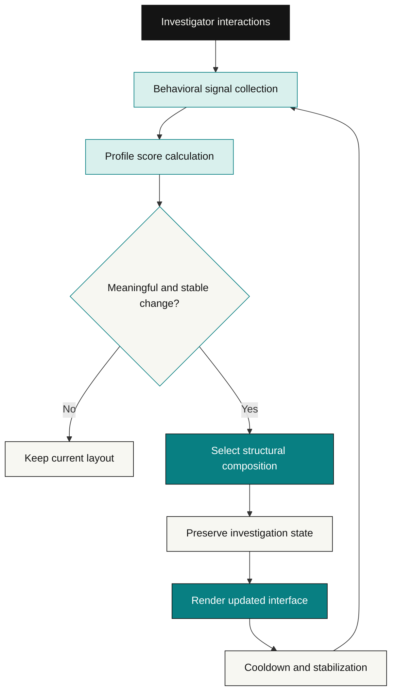

<div align="center">
  

  <p>
    
  </p>

  <p>
    <a href="https://palimpsest-ochre.vercel.app/">
      
    </a>
    <a href="https://github.com/Nub-programmer/Palimpsest">
      
    </a>
  </p>

  <p>
    
    
    
    
  </p>

  <p><b>Adaptive UX · Behavioral Computing · Interactive Investigation</b></p>
</div>

---

## The premise

Most interfaces are designed around a fixed assumption: every user should navigate, discover, and process information in the same way.

**PALIMPSEST experiments with a different idea.**

What if a digital workspace could recognize how you investigate information and reshape its structure around your behavior?

Rather than merely changing colors or typography, PALIMPSEST explores **structural adaptation**: changing how information is organized, which tools receive priority, and how evidence can be explored.

The result is an interactive investigation into a fictional information blackout, presented through an interface that can evolve with the investigator.

> Six structural forms. Five behavioral dimensions. One case that refuses to stay simple.

## At a glance

| | |
|:---|:---|
| **Project** | PALIMPSEST |
| **Category** | Adaptive interface / interactive investigation |
| **Core concept** | Behavior-informed interface composition |
| **Interface modes** | 6 structural forms |
| **Investigation** | Case File 09: The Missing Nine Minutes |
| **Behavior processing** | Local deterministic scoring |
| **Persistence** | Browser `localStorage` |
| **Frontend** | React, TypeScript and Vite |
| **Live application** | [palimpsest-ochre.vercel.app](https://palimpsest-ochre.vercel.app/) |

## The six structural forms

Each form represents a different investigative approach. **LEDGER** serves as the neutral starting point while meaningful interactions inform the behavioral profile.

<table>
  <tr>
    <td width="50%">
      <h3>01 / LEDGER</h3>
      <p><b>The neutral index</b></p>
      A structured overview for scanning records, metadata, and the overall evidence collection.
    </td>
    <td width="50%">
      <h3>02 / DOSSIER</h3>
      <p><b>The deep reader</b></p>
      An expanded reading experience designed around prolonged attention to primary sources and detailed records.
    </td>
  </tr>
  <tr>
    <td width="50%">
      <h3>03 / RELATION ATLAS</h3>
      <p><b>The associative explorer</b></p>
      A relationship-focused workspace that foregrounds cross-references, connected evidence, and graph exploration.
    </td>
    <td width="50%">
      <h3>04 / SIGNAL CONSOLE</h3>
      <p><b>The rapid investigator</b></p>
      A telemetry-oriented interface built around searching, filtering, and scanning for meaningful signals.
    </td>
  </tr>
  <tr>
    <td width="50%">
      <h3>05 / CHRONICLE</h3>
      <p><b>The temporal thinker</b></p>
      A chronological view for reconstructing events, examining timestamps, and tracing causality.
    </td>
    <td width="50%">
      <h3>06 / CROSS-EXAMINATION</h3>
      <p><b>The discrepancy auditor</b></p>
      A synchronized comparison workspace for identifying contradictions between records and testimonies.
    </td>
  </tr>
</table>

## How the interface evolves

The adaptation engine evaluates observable interactions instead of relying on random layout changes. Its purpose is to identify a meaningful pattern and use that pattern to inform interface composition.



### Behavioral signals

| Signal dimension | Observable behavior | Investigative interpretation |
|---|---|---|
| **Dossier** | Reading time, article completion, text scrolling | Prefers detailed examination |
| **Atlas** | Related-record navigation, graph-node exploration | Follows connections between evidence |
| **Console** | Search frequency, category filters, rapid scanning | Prioritizes efficient information retrieval |
| **Chronicle** | Sequential timeline interaction | Investigates through chronology |
| **Cross-Examination** | Document comparisons and contradiction pinning | Searches for inconsistencies |

### Preventing interface instability

An adaptive interface should not rearrange itself after every click. The documented evolution model includes stabilization rules:

- **Minimum interaction gate:** at least four meaningful investigative actions before automatic adaptation.
- **Hysteresis:** the leading profile must have a margin of at least 14%, or reach the documented absolute threshold of 42%.
- **Cooldown:** at least 15 seconds between automatic structural reconfigurations.
- **Judge Preview Mode:** `/app/evolution` provides a way to preview and lock the six layouts without replacing the investigator's actual behavior profile.

These controls help keep adaptation intentional, interpretable, and less distracting.

## Case File 09: The Missing Nine Minutes

<div align="center">
  
  
  
</div>

**Location:** Blackwood Deep-Core Subsurface Observatory  
**Incident date:** October 14, 2026  
**Critical window:** 23:41–23:50 UTC

Twelve interconnected fictional records describe a station blackout, an anomalous signal, an unexplained extraction, and conflicting accounts from the people present.

The objective is not simply to read the archive. It is to connect the records, reconstruct the sequence of events, and decide which evidence deserves closer scrutiny.

### Incident timeline

```mermaid
timeline
    title Case File 09 — The Missing Nine Minutes
    23:35 UTC : Dr. Vance signs the shift log
             : Keycard Gamma-7 is reported secured
    23:39 UTC : Surface seismograph registers 7.83 Hz infrasound
    23:41 UTC : Observatory blackout begins
             : CCTV footage is overwritten
    23:42 UTC : Hydrophone Array 4 detects anomalous harmonics
    23:44 UTC : Gamma-7 is swiped at Sub-Level 4
             : 42.8 kg is recorded as extracted
    23:45 UTC : Encrypted microwave transmission is detected
    23:50 UTC : Power returns
             : Generator fuel-line damage is discovered
    23:52 UTC : A confrontation between Vance and Lin is recorded
```

The evidence is intentionally fictional and is part of the application's investigation scenario.

## Design language

PALIMPSEST combines a technical archive aesthetic with a crisp, pixel-inspired visual identity.

| Element | Design direction |
|---|---|
| Canvas | Warm off-white `#F7F7F2` |
| Primary ink | Near-black `#141414` |
| Accent | Signal teal `#087F82` |
| Secondary accent | Pale teal `#D9F0ED` |
| Surfaces | White panels with strong structural borders |
| Shadows | Hard, offset shadows rather than diffuse glow |
| Typography | Pixel display lettering paired with readable monospace text |
| Motion | Purposeful transitions, subtle pixel signals, and restrained animation |

The visual language draws from retro computing and forensic interfaces without allowing visual effects to overwhelm the investigation itself.

## Technology

<p>
  
  
  
  
  
  
</p>

The repository's dependencies also include Lucide React, Express, dotenv, and the Google GenAI SDK. Check `package.json` and the source files for the exact implementation of each integration.

## Getting started

### Prerequisites

- [Bun](https://bun.sh/) or a compatible Node.js and npm installation
- Git
- A modern web browser

### 1. Clone the repository

```bash
git clone https://github.com/Nub-programmer/Palimpsest.git
cd Palimpsest
```

### 2. Install dependencies

Using Bun:

```bash
bun install
```

Alternatively, using npm:

```bash
npm install
```

### 3. Start the development server

```bash
bun run dev
```

Or:

```bash
npm run dev
```

Open the local URL printed by Vite. The configured development server uses port `3000`.

### 4. Build for production

```bash
bun run build
bun run preview
```

### 5. Run the TypeScript check

```bash
bun run lint
```

The current `lint` script runs TypeScript with `tsc --noEmit`.

### Environment variables

The repository includes an `.env.example` file. If a feature you intend to use requires environment variables, create a local `.env` from that template and supply the required values.

**Never commit API keys, tokens, passwords, or other secrets.**

## Testing the adaptive interface

The following recipes use the routes and controls documented by the application. Exact results depend on the current implementation and interaction history.

| Profile to explore | Suggested test |
|---|---|
| **DOSSIER** | Visit `/app/archive`, open a record such as `EV-01`, and spend time reading its content. Repeat with other records. |
| **RELATION ATLAS** | Follow cross-reference links between records and interact with relationship-graph nodes. |
| **SIGNAL CONSOLE** | Search for terms such as `42.7`, `Gamma-7`, and `Vance`; try multiple category filters. |
| **CHRONICLE** | Visit `/app/chronicle` and navigate sequentially through the timeline. |
| **CROSS-EXAMINATION** | Visit `/app/compare`, switch comparison pairs, and try the contradiction-pinning action. |
| **All six forms** | Visit `/app/evolution` and use Judge Preview Mode to inspect the available structural forms. |

For a meaningful test, interact with the application long enough to develop a behavioral pattern rather than judging adaptation from a single click.

## Persistence and user state

The documented implementation stores investigation state in browser `localStorage` under:

```text
palimpsest_investigation_state_v1
```

The persisted data includes investigation artifacts, notes, pinned evidence, working hypotheses, case theories, and behavioral telemetry.

State preservation is an important part of the project concept: changing the interface's structure should not unnecessarily erase the work that led to that change.

Use the application's reset controls when you need to begin a clean investigation or repeat an evaluation.

## Repository structure

```text
Palimpsest/
├── src/                 # Application source code
├── .env.example         # Environment variable template
├── .gitignore
├── README.md
├── bun.lock             # Bun dependency lockfile
├── index.html
├── metadata.json
├── package.json         # Dependencies and scripts
├── tsconfig.json        # TypeScript configuration
└── vite.config.ts       # Vite configuration
```

## Engineering principles

PALIMPSEST explores several principles that matter when interfaces respond to user behavior:

- **Deterministic adaptation:** the same meaningful interaction history should lead to consistent decisions under the same conditions.
- **Stability:** thresholds and cooldowns should prevent distracting structural oscillations.
- **State continuity:** layout changes should respect ongoing tasks, notes, and selections.
- **Meaningful signals:** background tabs and incidental interactions should not be mistaken for genuine engagement.
- **Inspectable behavior:** profile scores and adaptation decisions should be understandable enough to evaluate.
- **Progressive enhancement:** motion and visual treatments should support usability rather than obscure content.

These principles also form a practical checklist for future testing and development.

## Contributing

Suggestions, bug reports, and focused pull requests are welcome.

1. Fork the repository.
2. Create a branch for your change.
3. Keep the change focused and explain its intended behavior.
4. Test the relevant workflow.
5. Include screenshots or a short recording for significant UI changes.

For substantial proposals, open an issue first so the problem and intended approach can be discussed.

## License

No `LICENSE` file is currently listed in the repository. Until a license is added, do not assume that the project can be reused, redistributed, or modified under an open-source license.

---

<div align="center">
  

  <p><b>PALIMPSEST</b></p>
  <p><i>The interface is part of the investigation.</i></p>
  <p>
    <a href="https://palimpsest-ochre.vercel.app/">Live Demo</a>
    ·
    <a href="https://github.com/Nub-programmer/Palimpsest">Source Code</a>
    ·
    <a href="https://github.com/Nub-programmer/Palimpsest/issues">Report an Issue</a>
  </p>
</div>
